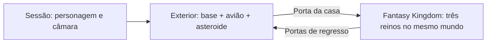

# Espaço exterior partilhado

16 outubro 2026. Implementado pelo plugin oficial Unity CLI/Pipeline.

## Abrir o projeto

Abrir **`Assets/_FirstJourney/Scenes/FirstJourney_EspacoExterior.unity`** e carregar em Play. É a nova cena inicial da lista de cenas do Editor. Ela carrega a base e o asteroide de destino em modo aditivo. No Editor podem estar abertas as três cenas para rever o conjunto; também funciona ao abrir apenas a cena inicial.

O personagem começa na base. O avião, a ponte e a arte original continuam nos lugares existentes. O asteroide que dá acesso ao Fantasy Kingdom está em **`(0,0,180)`**, a 180 metros do centro da base, à mesma escala. Esta distância é ajustável na cena de conteúdo do asteroide.

**Embarque e voo arcade implementados nesta continuação.** O avião original permite viajar até ao asteroide e regressar, com aproximação final guiada e desembarque em chão seguro. Ver [controlos e verificação do avião](Aviao_Voo_Arcade.md) e `Aviao_Playtest.json`. Os pontos `Saida_Base`, `Cruzeiro` e `Aproximacao_Asteroide` conservam-se como referências da montagem, sem piloto automático para a viagem inteira.

## Organização

| Cena | Responsabilidade |
| --- | --- |
| `Scenes/FirstJourney_EspacoExterior.unity` | Sessão, único personagem, câmara, áudio, céu e luzes do exterior |
| `Scenes/Exterior/FirstJourney_Base_Conteudo.unity` | Base original, ilha do avião, avião e ponte |
| `Scenes/Exterior/FirstJourney_Asteroide01_Conteudo.unity` | Asteroide de destino e casa, na posição partilhada |
| `Scenes/Worlds/FirstJourney_FantasyKingdom_Conteudo.unity` | Mundo Fantasy Kingdom, com os três reinos/regiões; sem personagem ou câmara próprios |

Todos os caminhos da tabela são relativos a `Assets/_FirstJourney/`.

`FJWorldSession` mantém a cena de sessão e as duas cenas exteriores carregadas. Ao entrar pela porta, oculta os objetos e colisores do exterior e carrega o mundo em modo aditivo. Assim não se misturam fisicamente os terrenos da base e do Fantasy Kingdom, embora o mundo use coordenadas próximas da origem.

Ao regressar, descarrega o mundo, torna o exterior visível e coloca o mesmo personagem diante da casa no asteroide de destino, perto de `(-1.175,0.04,182.15)`. As três portas continuam a levar ao mesmo asteroide. As folhas exteriores são repostas fechadas para a próxima utilização.

O avião e as duas ilhas conservam as suas instâncias. A posição do avião não é reposta durante a visita ao mundo. Esta conservação vale durante a sessão em execução; **não é um sistema de gravação em disco**. Reiniciar o jogo ainda repõe a montagem inicial.

Não foi acrescentado Addressables, origem flutuante, gravidade radial ou um sistema de streaming por distância: o exterior atual é pequeno e tem apenas dois destinos físicos. A organização aditiva permite acrescentar conteúdos sem duplicar o personagem e a câmara.

## Preservação e compatibilidade

As três cenas anteriores (`FirstJourney_LuaBase`, `FirstJourney_Asteroide01` e `FirstJourney_Reino01_FantasyKingdom`) foram preservadas byte a byte como versões de referência/teste isolado. As novas cenas de conteúdo foram criadas por cópia com as APIs do Editor. As portas antigas continuam a usar a transição independente quando não existe `FJWorldSession`.

A lua-base conserva SHA-256 `31E01E8E14F302A09DEC7C200E9449FF99851D02BC3D21E70389B2C2D0B8758F`. Foram mantidos os 584 renderers da arte original e as 38 peças do avião. Nenhuma alteração ao motor de salto ou aos parâmetros de colisão nesta reorganização.

Na cópia de conteúdo do Fantasy Kingdom, o objeto de metadados `SceneIDMap` do exemplo foi removido porque tinha uma referência de script ausente e gerava avisos a cada carregamento. A cena fonte não foi alterada.

## Verificação inicial da organização (antes do voo)

`Docs/Exterior_Playtest.json` confirma três ciclos de entrada e regresso, um por casa/região do mundo. Foram conservadas as instâncias do personagem, câmara, avião e cenas exteriores; o mundo foi descarregado a cada saída. Em cada regresso houve contacto no piso do asteroide de destino, uma única câmara/motor ativos e a porta exterior voltou a fechar.

Para verificar a conservação do avião sem implementar voo, o teste colocou-o temporariamente no ponto de chegada do asteroide. Depois das visitas, o avião manteve a mesma posição e instância, a cerca de 3.67 m do personagem. O teste restaurou a posição inicial do avião na base. **Esta colocação por código não demonstra voo ou aterragem.** Os testes também colocaram o personagem junto das portas do mundo para isolar a passagem; não certificam os percursos completos entre os três reinos.

A cena de entrada foi iniciada também sozinha, confirmando o carregamento das outras duas cenas e a chegada do personagem ao piso da base. Teclado e botão West/Quadrado de comando virtual exercitados; dispositivos físicos restaurados. Não foi testado manualmente um comando físico nesta entrega.

Relatórios: `Exterior_Construcao.json`, `Exterior_Playtest.json` e `Exterior_Validacao.json`. Captura real: `Assets/_FirstJourney/Review/EspacoExterior_Conjunto.png`. Não foi gerada ou testada uma build independente.

A inspeção final do exterior confirmou zero materiais/scripts ausentes, uma câmara, um motor e um listener ativos, compilação sem falha e zero erros de Console. Ficou um aviso do Unity AI Account API, já conhecido; não era uma falha do carregamento de cenas.

Os relatórios `Exterior_*` desta secção são o registo histórico da organização anterior ao voo. O percurso pilotado atual e o estacionamento efetivo são descritos em `Aviao_Voo_Arcade.md` e verificados em `Aviao_Playtest.json`.

Autoria: `AgentScripts/SharedExteriorSetup.cs`, `SharedExteriorPlaytest.cs` e `SharedExteriorReview.cs`. Trabalho guardado localmente, sem novo envio ao GitHub.
